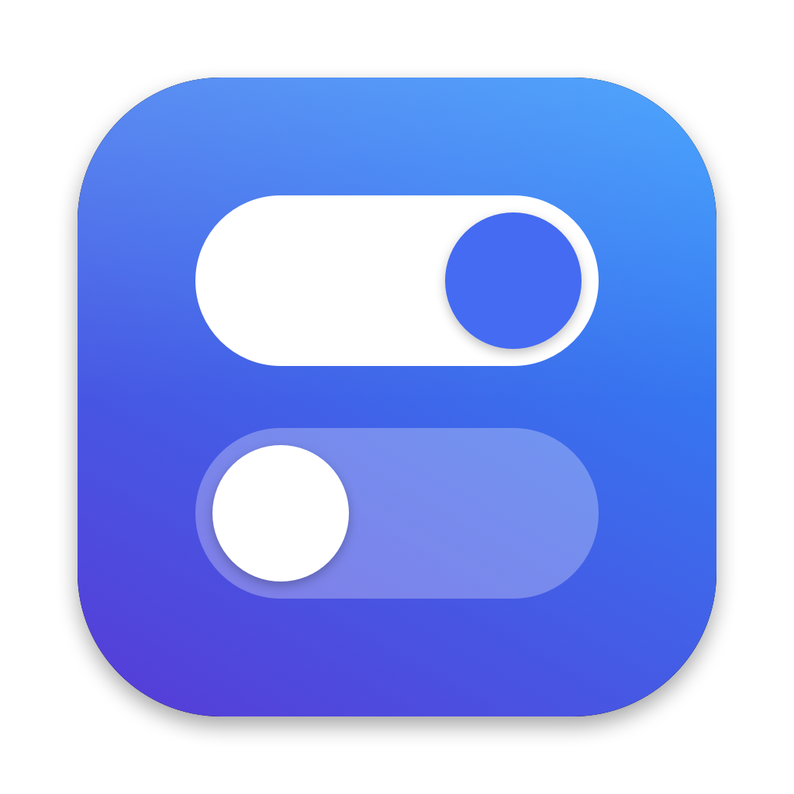

<p align="center">
  
</p>

<h1 align="center">QuickSwitch 开关栏</h1>

<p align="center">
  轻量、开源的 macOS 菜单栏开关工具 —— 点一下，切换常用系统设置。<br>
  <sub>A tiny, open-source menu bar toggle app for macOS.</sub>
</p>

<p align="center">
  
  
  
</p>

---

## ✨ 特点

- **一个菜单搞定**：常用系统开关集中在菜单栏，不用翻系统设置
- **状态实时准确**：每次打开菜单都直接读取系统当前状态，在别处改过也不会错
- **打开不卡顿**：状态读取走 CFPreferences / CoreAudio 原生接口，不启动额外进程
- **纯净无依赖**：单个 Swift 文件，约 400 行，无第三方库，无联网，无数据收集
- **中文界面**，不占程序坞

## 🎛 功能

### 开关

| 开关 | 说明 |
|---|---|
| 🔇 静音 | 静音 / 恢复系统声音 |
| 🗂 隐藏桌面文件 | 桌面上的文件全部隐藏，文件不会被删除，访达「桌面」文件夹里照常可见 |
| 🌅 夜览 | 屏幕色温变暖，晚上更护眼 |
| 🪟 台前调度 | 开启后屏幕左侧显示最近使用的应用 |
| 🌙 深色模式 | 切换深色 / 浅色外观 |
| ☕️ 防止休眠 | 保持屏幕常亮；退出 QuickSwitch 后自动恢复 |
| ⬇️ 自动隐藏程序坞 | 程序坞自动隐藏，腾出屏幕空间 |
| 👁 显示隐藏文件 | 访达中显示 `.` 开头的隐藏文件 |

### 操作

| 操作 | 说明 |
|---|---|
| 🧽 屏幕清洁 | 所有屏幕全黑，屏蔽键盘和鼠标，放心擦屏幕和键盘。**按住 Esc 2 秒退出**，或 2 分钟后自动退出 |
| ⏏️ 推出外接磁盘 | 一键推出 U 盘、移动硬盘、SD 卡和磁盘映像。插着外接磁盘时才显示 |
| 📺 退出投屏 | 取消显示器镜像。镜像（投屏）时才显示 |

另有「开机启动」选项。

## 📦 安装

需要 **macOS 13 及以上**，以及 Xcode 命令行工具：

```bash
xcode-select --install
```

然后克隆并编译：

```bash
git clone https://github.com/prompt2app/QuickSwitch.git
cd QuickSwitch
./build.sh
```

`build.sh` 会编译、ad-hoc 签名，安装到 `/Applications/QuickSwitch.app` 并启动。之后菜单栏会出现一个双拨动开关图标。

**更新**：`git pull && ./build.sh`

**卸载**：退出 QuickSwitch，删除 `/Applications/QuickSwitch.app` 即可。

## 🔐 权限说明

| 时机 | 弹窗 | 原因 |
|---|---|---|
| 首次切换「深色模式」 | 允许控制「系统事件」 | macOS 只能通过系统事件切换外观，点「允许」即可 |

其他功能不需要额外授权。

## ⚠️ 已知限制

- **夜览**调用了系统私有框架 CoreBrightness，未来 macOS 版本可能失效
- **退出投屏**只是取消镜像，AirPlay 连接本身不会断开，电视会变成一块扩展屏；彻底断开需在「系统设置 → 显示器」中操作
- **屏幕清洁**无法屏蔽亮度、音量、电源、触控 ID 等硬件按键
- 切换「隐藏桌面文件」「显示隐藏文件」会重启访达，切换「自动隐藏程序坞」会重启程序坞，界面闪一下属正常现象
- 由于是 ad-hoc 签名，重新编译后需要重新勾选「开机启动」

## 🛠 开发

```
QuickSwitch/
├── main.swift          # 全部代码
├── Info.plist          # 应用配置
├── build.sh            # 编译 + 安装 + 启动
└── icon/
    ├── make_icon.swift # 用代码绘制应用图标
    ├── icon_1024.png
    └── AppIcon.icns
```

### 添加新开关

在 `main.swift` 的 `switches` 数组里加一项：

```swift
Switch(title: "名称", symbol: "SF Symbol 名称",
       isOn: { /* 返回当前是否开启 */ },
       set: { on in /* 执行开启或关闭 */ })
```

`symbol` 可在 Apple 的 [SF Symbols](https://developer.apple.com/sf-symbols/) 应用里查找。

### 重新生成图标

```bash
cd icon
swift make_icon.swift icon_1024.png
mkdir AppIcon.iconset
for s in 16 32 128 256 512; do
  sips -z $s $s icon_1024.png --out AppIcon.iconset/icon_${s}x${s}.png
  sips -z $((s*2)) $((s*2)) icon_1024.png --out AppIcon.iconset/icon_${s}x${s}@2x.png
done
iconutil -c icns AppIcon.iconset -o AppIcon.icns && rm -rf AppIcon.iconset
```

## 🤝 参与贡献

欢迎提 Issue 和 Pull Request：新开关的点子、Bug 反馈、新系统的适配都可以。

## 📄 许可证

[MIT](LICENSE)
